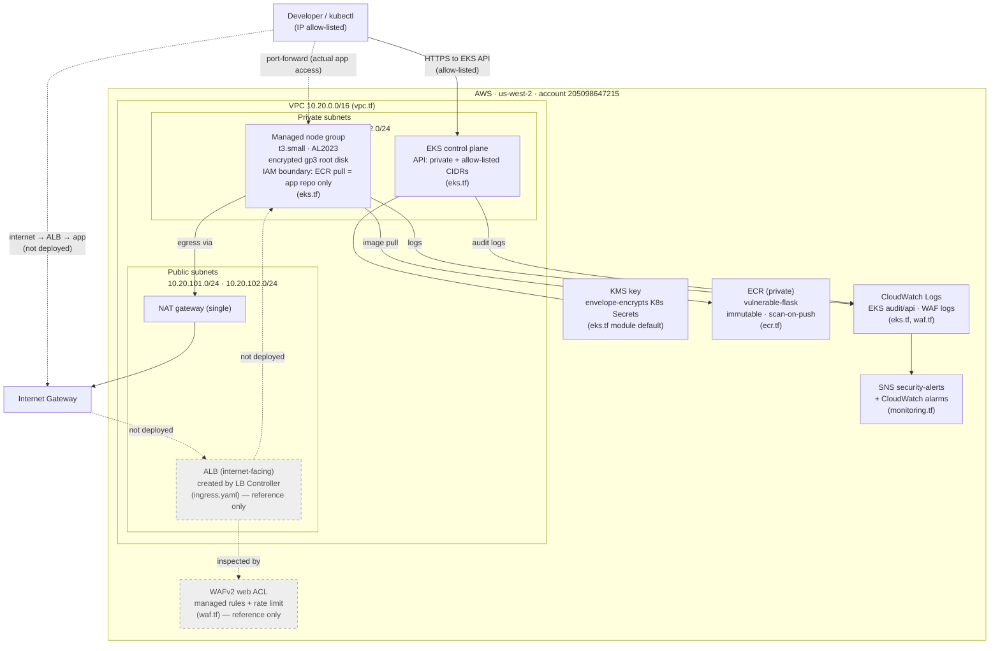
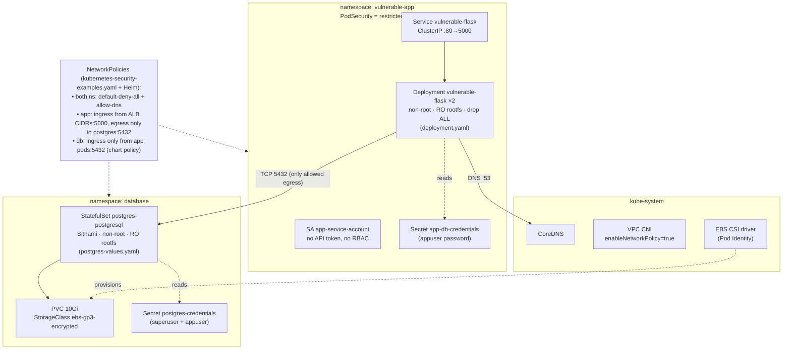
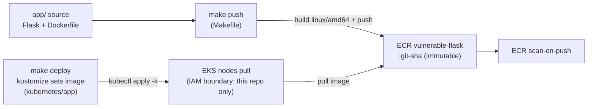
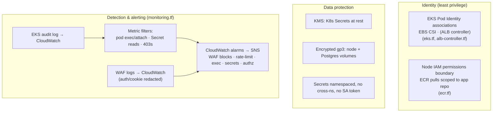

# Architecture

How the pieces fit together, from AWS down to the pods. Mermaid diagrams
render on GitHub and in most IDEs. Dashed lines / grey nodes = defined in
code but **not deployed** in the homelab (the public WAF+ALB path).

- **AWS:** account `205098647215`, region `us-west-2`
- **Cluster:** EKS `eks-interview-lab`, Kubernetes 1.32
- Source of each box is noted as `(file.tf)` / `(file.yaml)`.

---

## 1. Network & AWS topology

**Reads as:** you reach the cluster API over an IP-allow-listed public
endpoint and the app via `kubectl port-forward`. Nodes live in private
subnets, pull the app image from private ECR, and reach the internet only
outbound through the NAT gateway. The public **ALB + WAF** path is coded but
left undeployed so the vulnerable app isn't exposed (see `waf.tf`,
`ingress.yaml`).

---

## 2. Inside the cluster (namespaces, workloads, network policy)

**Reads as:** two locked-down namespaces. The app can talk to DNS and to
Postgres on 5432 and nothing else; Postgres only accepts the app. Each pod
reads only its own namespace's Secret, runs non-root with a read-only root
filesystem, and carries no Kubernetes API token.

---

## 3. Build & deploy flow

**Reads as:** `make push` builds the amd64 image and pushes an immutable
`:git-sha` tag to private ECR (scanned on push); `make deploy` stamps that
tag into the manifests and applies them; nodes pull it — and the node IAM
permissions boundary lets them pull from *only* this repo and AWS's EKS
add-on registry.

---

## 4. Security controls & monitoring

**Reads as:** identities are least-privilege (Pod Identity per controller, a
boundary on the node role); data is encrypted at rest and Secrets are
tightly scoped; and the audit/WAF logs feed metric filters and alarms that
notify an SNS topic. The exec/secret-read/403 metric pipeline is verified
live (see `docs/FINDINGS.md` → Live verification).

---

## Where things live

| Concern | Files |
|---|---|
| Network / VPC | `terraform/vpc.tf` |
| EKS, nodes, add-ons, KMS, disk | `terraform/eks.tf` |
| Private registry + node boundary | `terraform/ecr.tf` |
| WAF (reference) | `terraform/waf.tf`, `alb-controller.tf`, `kubernetes/app/ingress.yaml` |
| Monitoring & alerting | `terraform/monitoring.tf` |
| K8s baseline (ns, netpol, SA, quota) | `kubernetes/kubernetes-security-examples.yaml` |
| App workload | `kubernetes/app/` |
| Database (Helm values, schema) | `database/` |
| Build/deploy | `Makefile`, `kubernetes/app/kustomization.yaml` |
| Full findings & verification | `docs/FINDINGS.md` |
| Secrets & monitoring detail | `docs/SECRETS_AND_MONITORING.md` |
